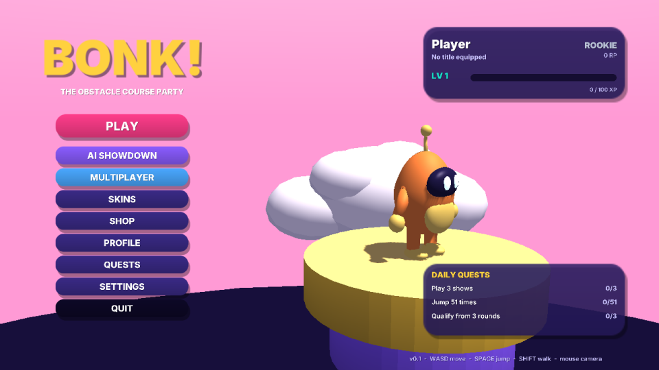
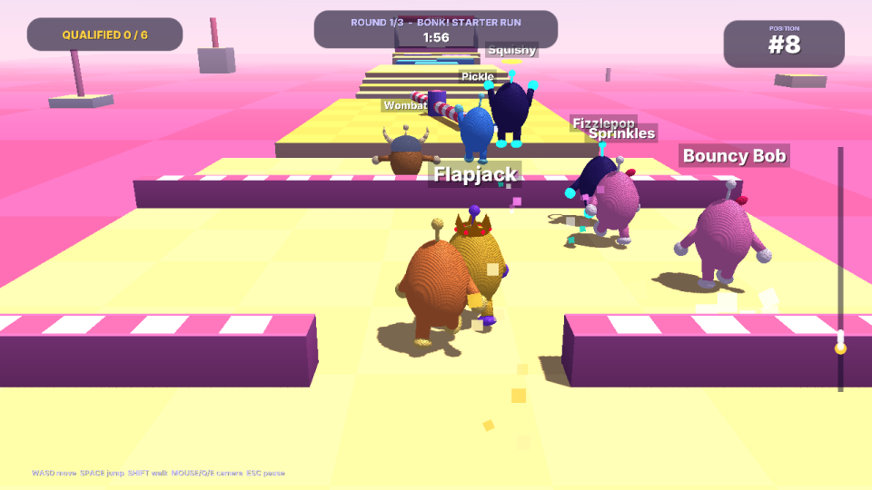
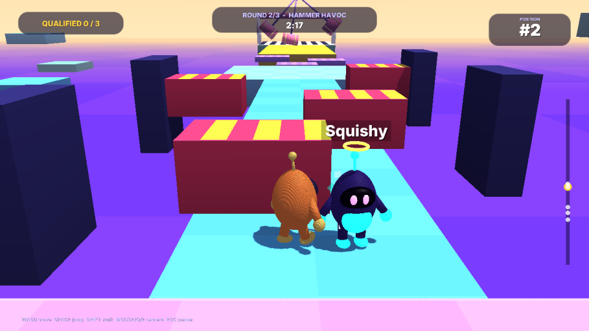
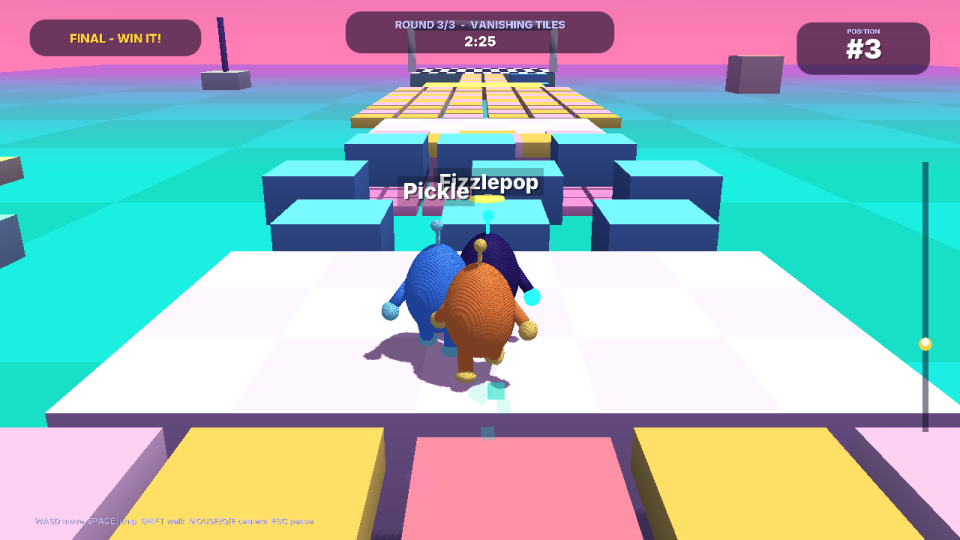
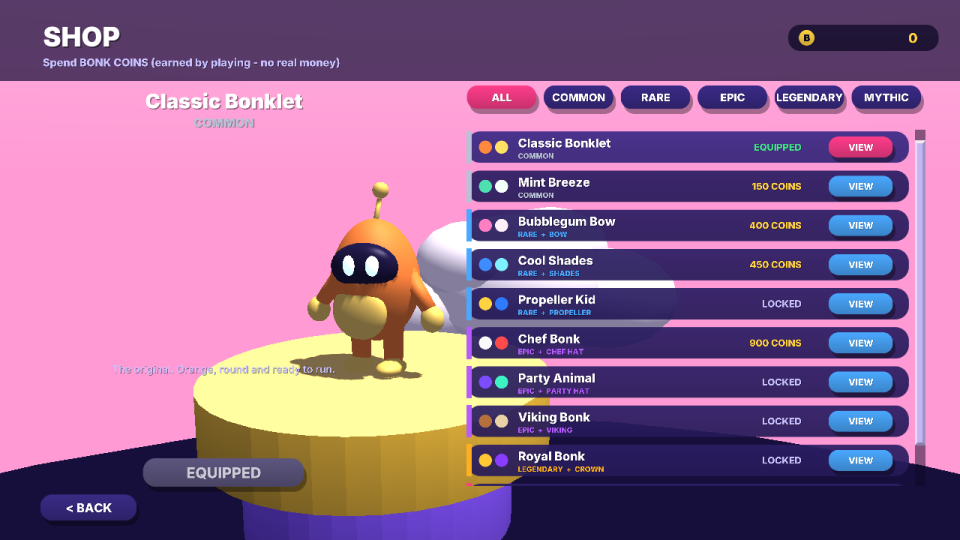
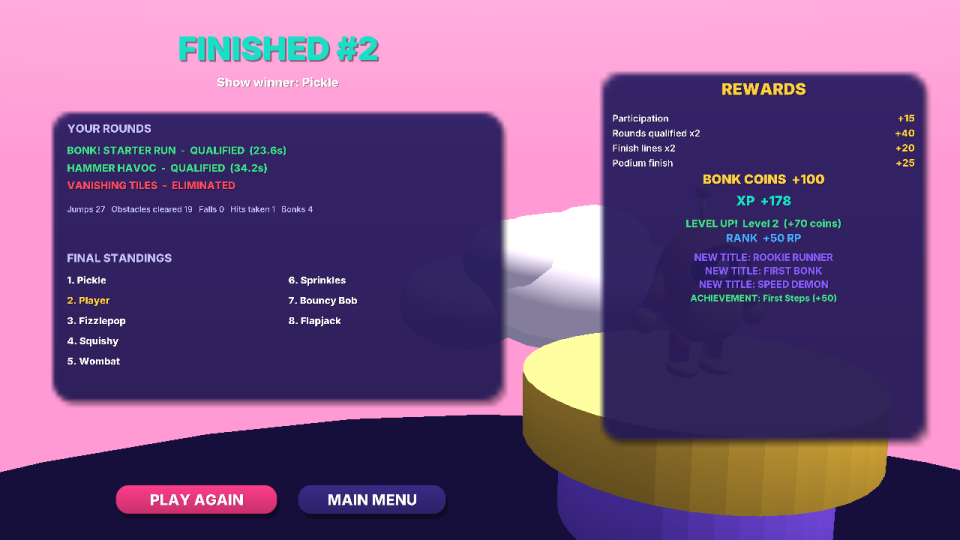
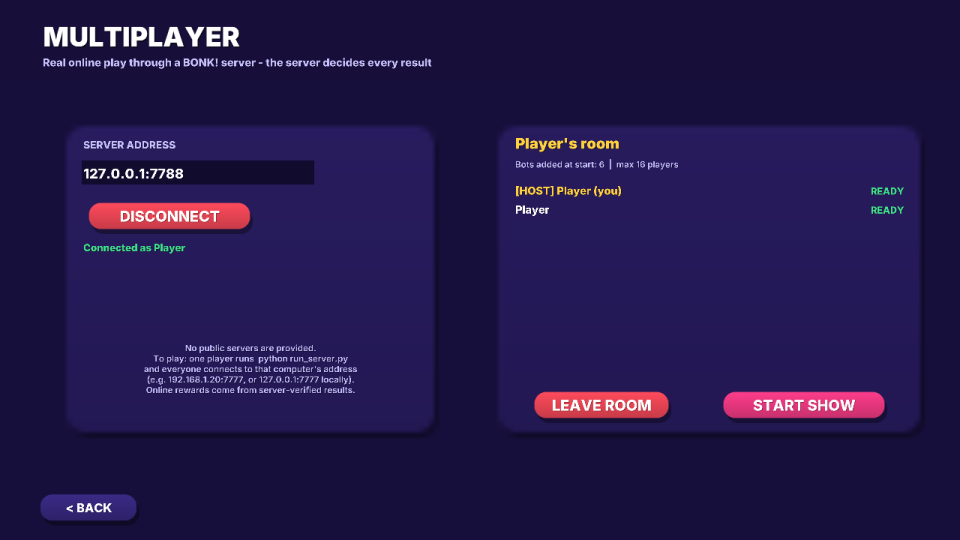
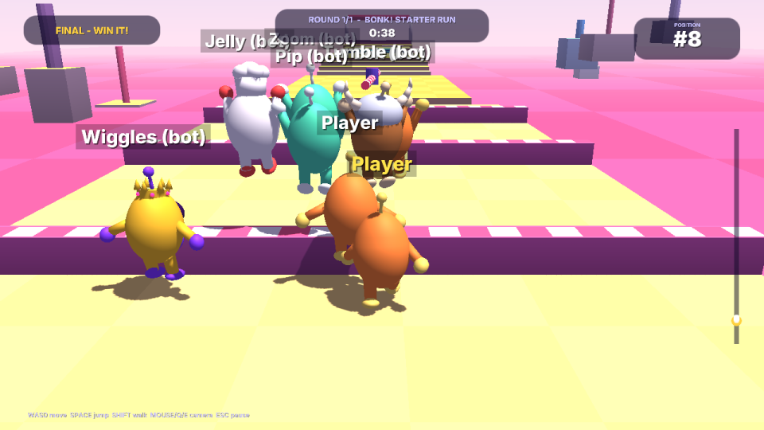
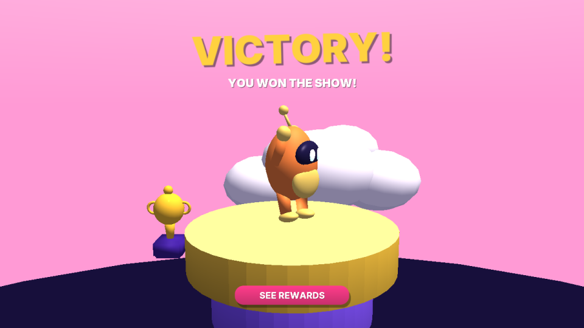
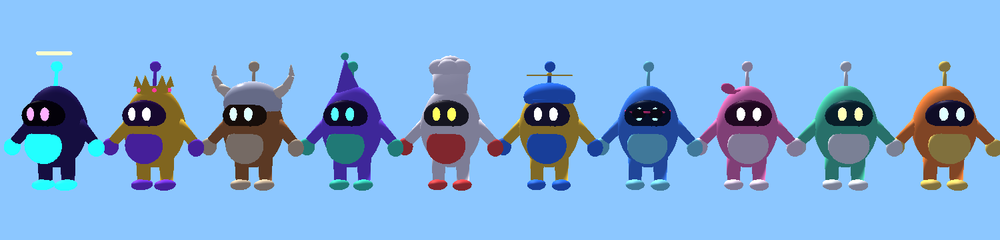

# BONK! — the obstacle-course party game

An original 3D party game written in **Python** with **Panda3D**. Up to 16 players
race through colourful obstacle courses, dodge swinging hammers, sweeping bars and
pistons, hop across vanishing tiles and try to survive until the final round.
Play against local AI bots, or against real players through the included
authoritative game server.

The character, its animations, the skin accessories and the course props were
built with **Blender 5.2** from a script (`blender/`). Everything else (courses,
UI, sound effects, music) is generated by the project itself. No assets from
other games are used. All in-game currency is virtual; there are no real-money purchases.

| Main menu | Starter Run | Hammer Havoc |
|---|---|---|
|  |  |  |
| **Vanishing Tiles (final)** | **Shop** | **Rewards** |
|  |  |  |
| **Online room (real server)** | **Online race, seen by client 2** | **Victory** |
|  |  |  |

Skins (all with real Blender-made accessories) and the 8 character animations:



---

## 1. Status at a glance

| Area | Status |
|---|---|
| AI SHOWDOWN (you vs. bots, 3-round show with eliminations) | **Working and played end to end** |
| Quick race on any single course | **Working** |
| 3 courses (Starter Run, Hammer Havoc, Vanishing Tiles) | **Working, verified completable by bots** |
| Character physics, jumping, collisions, hazards, moving platforms, vanishing tiles | **Working, unit-tested** |
| Bot AI with EASY / NORMAL / HARD / CHAOTIC behaviour | **Working, benchmarked** |
| Blender character + rig + 8 animations, 8 accessories, 6 props | **Working, real GLB files verified in Panda3D** |
| Skins, shop, BONK COINS, XP/levels, ranks, titles, daily quests, achievements | **Working, unit-tested** |
| Saving (validated JSON, atomic writes, backup, corruption recovery) | **Working, unit-tested** |
| All 20 screens (menus, HUD, pause, victory, results, shop, profile…) | **Working** |
| MULTIPLAYER (authoritative server + clients) | **Working on a local machine / LAN, tested with separate processes and with two real game windows.** No public server, no accounts, no internet matchmaking (see §11). |
| Gamepad | Implemented, **not tested** (no device available) |
| Audio | Sounds and music are generated and loaded; **not heard** in the test environment (it had no sound card) |

## 2. Requirements and installation

* **Python 3.13** (the full game was tested on 3.13; the game logic and its tests also pass on 3.11 and 3.12)
* **Panda3D 1.10.16** and **panda3d-gltf 1.3.0** (installed from `requirements.txt`)
* A graphics card with OpenGL 3 or newer (software rendering also works, just slower)

```bash
cd BONK
python -m venv .venv
# Windows: .venv\Scripts\activate      Linux/macOS: source .venv/bin/activate
pip install -r requirements.txt
```

On Windows you can double-click **`install.bat`** instead, then **`run_game.bat`**.

Blender is **not** needed to play: the exported models are included in `assets/models/`.

## 3. Running

| What | Command |
|---|---|
| Play the game | `python main.py` (or `run_game.bat` / `./run_game.sh`) |
| Start a multiplayer server | `python run_server.py` (default port 7777) |
| Run all automated tests | `python -m unittest discover -s tests` |
| Multiplayer check: server + 2 client processes | `python tools/mp_selftest.py` |
| Bot benchmark on all courses | `python tools/ai_benchmark.py --seeds 3` |
| One headless round with bots | `python tools/sim_round.py hammer_havoc --bots 16 --difficulty HARD -v` |
| Headless full show | `python tools/sim_show.py --players 16` |
| Automated playthrough of the real game, with screenshots | `python main.py --autoplay --shots shots/` |
| Rebuild the 3D assets with Blender | `blender -b -P blender/export_assets.py` or `python blender/export_assets.py` (with `pip install bpy`) |
| Regenerate the sound effects and music | `python tools/gen_audio.py` |

Progress is saved to `BONK/saves/profile.json`. Set `BONK_SAVE_DIR` to use another folder.

## 4. Controls

| Action | Keyboard / mouse | Gamepad (untested) |
|---|---|---|
| Move | **W A S D** or arrow keys | left stick |
| Jump | **SPACE** | A / cross |
| Walk carefully (default is running) | hold **SHIFT** | B / circle, or a light stick push |
| Camera | **mouse**, or **Q / E** | right stick |
| Pause | **ESC** | — |
| Spectate another player after elimination | **A / D** | — |

Movement is relative to the camera. "Always run" can be switched off in SETTINGS
(then SHIFT runs instead).

## 5. Game modes

### BONK! AI SHOWDOWN (single player)
`PLAY` starts immediately with your saved settings; `AI SHOWDOWN` opens the lobby, where you pick:
* **FULL SHOW**: three rounds. 16 players → about 11 qualify on Starter Run → about 6 on Hammer Havoc → one winner on Vanishing Tiles.
* **QUICK RACE**: one course of your choice; first across the line wins.
* number of bots (1–15) and their difficulty (EASY, NORMAL, HARD, CHAOTIC or MIXED).

Each round runs **COUNTDOWN → ROUND_START (GO!) → ROUND_ACTIVE → ROUND_END → RESULTS**, and the show ends in **GAME_OVER** with the champion, your final place and your rewards.
If you are eliminated you can spectate the rest of the show or leave.

### BONK! MULTIPLAYER
1. One player runs `python run_server.py` (`--port`, `--maps`, `--host` are optional).
2. Everyone opens **MULTIPLAYER**, types the server address (`127.0.0.1:7777` on the same PC, or the host's LAN IP such as `192.168.1.20:7777`), and clicks **CONNECT**.
3. One player clicks **CREATE ROOM**; the others **JOIN** and press **READY**.
4. The host presses **START SHOW**. Empty places are filled with bots on the server (6 by default).

There are **no public servers**: you must run one yourself. Over the internet you
would need port forwarding or a hosted machine; see §11 for what a real deployment still needs.

## 6. The courses

All courses are JSON files in `data/maps/`; dropping in a new file adds a course (see §10).

| Course | Content | Falling |
|---|---|---|
| **BONK! STARTER RUN** (easy, 120 s) | wide runway with hurdles (one row has a gap to run through), a 3 m gap, a slow low sweeper, climbable stairs, stepping stones, two ferry platforms, more hurdles | back to the last of 4 checkpoints |
| **HAMMER HAVOC** (medium, 150 s) | three narrow bridges with 6 swinging hammers, a fast two-arm sweeper, piston alley that shoves you off the walkway, 3 sideways-drifting platforms, a gauntlet of 3 giant hammers | back to the last of 3 checkpoints |
| **VANISHING TILES** (hard, 150 s) | 84-tile field (tiles flash then drop when touched), three chains of small pads with precise jumps, an upper tile field over a lower "second-chance" tile floor, a 2-wide vanishing bridge | **eliminated** |

Every course defines a start grid, a finish line, world bounds and a kill height
(leaving them counts as a fall), checkpoints, bot waypoints, a colour theme and a time limit.

## 7. What is implemented, system by system

### Physics and movement (`src/bonk/sim/`)
A deterministic **fixed 60 Hz** kinematic character controller written in pure Python, so
the client, the bots and the server share exactly the same rules:
walk (3.2 m/s) and run (7 m/s), acceleration and air control, gravity, jump (1.67 m apex), coyote time and jump
buffering, no double jumps (a held key never repeats), step-up onto small ledges, ground snapping on
steps, collision with walls/ceilings (cylinder vs. boxes), moving platforms that carry you, jump pads,
vanishing tiles, swinging hammers and sweepers as capsule hazards with knock-back and stun, pistons, and player-vs-player
pushing. Landing on someone's head is a **BONK!**: you bounce and they are briefly stunned.

Movement **state** (IDLE, WALK, RUN, JUMP, FALL, LAND, TUMBLE, RESPAWNING, ELIMINATED, VICTORY)
is computed by the physics. The **animation** layer only reads it: it cross-fades clips and scales
walk/run play rate by real ground speed so feet don't slide.

### Bot AI (`src/bonk/ai/`)
Bots are full players: same body, same physics and same top speed, controlled only through the same input commands as a human (no teleporting, no ghosting through obstacles; a test checks that a bot never moves more than 1 m in a tick). Each bot has:
* **route following** along course waypoints with a chosen lateral line (lane) and alternative routes (the lower floor of Vanishing Tiles);
* **sensors**: ground probes (including where a moving platform *will be*), edge detection, wall/hurdle detection, tile-vanish prediction, and hazard prediction (a hammer's or piston's future position is computed from the course clock);
* **decisions**: picking a safe line, waiting for a gap in hammers or pistons, jumping over hurdles and gaps, finding a landing spot in a fan of directions, steering mid-air to land on small pads, riding ferries, jumping just before a sweeper bar arrives, avoiding occupied pads, and recovering when stuck or knocked off the line.

Difficulty profiles change behaviour, not speed:

| Profile | Behaviour |
|---|---|
| EASY | slow re-planning (0.3 s), short look-ahead, imprecise jumps, sometimes misses an edge, often ignores hammer timing, hesitates and walks |
| NORMAL | sensible lines, times most obstacles, occasional mistakes |
| HARD | re-plans every 0.05 s, predicts every hazard and tile, precise landing spots |
| CHAOTIC | weaves, hops for fun, likes to shove people, but still uses the safety logic |

### Rounds and show (`src/bonk/game/`)
`GameManager` runs the states **LOBBY, COUNTDOWN, ROUND_START, ROUND_ACTIVE, ROUND_END, RESULTS, GAME_OVER**
(illegal transitions raise an error). A round ends when the qualification quota is reached, when nobody
is left running, or when the time limit expires. The final ends with the first finisher. The rules never let it hang:
* if everyone falls in the final, the **last one to fall** wins;
* if nobody finishes a non-final round, the furthest survivors advance (at least one);
* when time runs out, the furthest player wins the final;
* players who disconnect or quit are removed at once.

### Skins and cosmetics (`data/skins.json`, `src/bonk/cosmetics/`)
Ten skins, each with real visual differences: four recoloured material zones (body, accent, visor, eyes), and
eight of them have a Blender-made accessory attached to the head joint (bow, shades, propeller cap with spinning blades, chef hat,
party hat, viking helmet, crown, halo). Some also have glow or a particle trail (confetti, sparkle, stardust).
`SkinDefinition` has an id, name, rarity, price, asset paths, description and unlock requirements (level, rank or achievement).
**Rarity is data** (COMMON, RARE, EPIC, LEGENDARY, MYTHIC, each with an order, colour and price band); it is used
for sorting, the shop tabs and price validation. Bots wear random skins.

### Economy (`src/bonk/economy/`)
**BONK COINS** are earned by taking part, qualifying, crossing finish lines, winning, finishing on the podium, completing quests,
unlocking achievements and levelling up. The shop:
* refuses purchases without enough coins or before the unlock rules are met;
* never charges twice (ownership check, one transaction id per item, and the button is disabled while a purchase runs);
* reports a purchase as done only **after it was saved to disk**; if saving fails, the coins and the skin are rolled back.

### Progression (`data/progression.json`, `src/bonk/progression/`)
* **XP and levels**: level n→n+1 needs `100 + 40·(n−1)` XP, up to level 50. Every level pays coins once, with bonuses at 5, 10, 20, 30 and 50.
* **Ranks**: ROOKIE 0, BRONZE 100, SILVER 250, GOLD 450, PLATINUM 700, DIAMOND 1000, MASTER 1400, BONK LEGEND 2000 Rank Points.
  Fixed, published rules: win +60, reaching the final +30, +10 per qualified round, out in round 1 −10,
  leaving early −15. Gains are scaled by bot difficulty. Nothing is random. This is the **local** rank vs. bots;
  online shows do not change it (the server keeps its own leaderboard from verified results only).
* **Titles**: 9 titles (FIRST BONK, SPEED DEMON, SURVIVOR, JUMP MASTER, CROWN CHASER, UNSTOPPABLE, …), each with an id,
  name, description, condition, rarity and unlock state. One can be equipped; it shows on the profile and above your head in races.
  A title cannot be equipped before its condition is met.
* **Daily quests**: 3 per day from 8 templates (play shows, finish courses, qualify, jump over obstacles, jump, win, bonk heads, win streak).
* **Achievements**: 12, each with progress, a coin reward paid once, and completion state.

### Saving (`src/bonk/save/`)
One versioned JSON file containing settings, coins (with a short ledger), level/XP, local rank, owned and equipped
skins, titles, achievements, quests and statistics. It is written atomically (temp file, fsync, rename), the previous good
save is kept as `.bak`, and every field is type-checked and clamped on load. A corrupt file is moved
aside (`profile.json.corrupt-<time>`), and the game continues from the backup or from defaults with an on-screen
notice. No passwords, tokens or secrets are stored. The file is editable by the player, so it is **never trusted for online ranking**.

### Multiplayer (`src/bonk/multiplayer/`)
* **Server** (asyncio, TCP, newline-delimited JSON): rooms with a host, ready flags, up to 16 players and bot fill.
  It runs the same `GameManager`, physics and bot AI at 60 Hz and sends snapshots at 20 Hz, plus events, round results and the final standings.
* **Clients send only inputs** (`move x/y, jump, walk`). Every message is schema-validated: unknown types or extra fields
  (for example a smuggled position) are rejected, numbers must be finite, the move vector is clamped, inputs are rate-limited
  (90/s) and replayed sequence numbers are ignored. More than 20 invalid messages gets a client kicked.
* **The server decides** positions, eliminations, the finish order, winners and each player's match report
  (`verified_by_server: true`). It also appends every finished match to `server_data/results.jsonl` and keeps
  `online_leaderboard.json`.
* **Disconnects**: the player is removed from the room and from the running round, the others are told, and the show continues.
  If the host leaves, a new host is chosen; empty rooms are closed.
* **Client**: non-blocking socket polled every frame (no threads), shared by the game and the tests. The game client
  interpolates between snapshots and animates obstacles from the server's course clock.

### User interface (`src/bonk/client/ui/`)
Screens: splash, main menu, mode select, lobby, course select, loading, in-game HUD, pause, victory, final results with rewards,
shop, skins (locker), profile, levels & XP, ranks, titles, quests, achievements, settings and multiplayer. The HUD shows
round, time, qualified count, your position, a course-progress strip with every player, banners, an event feed and between-round results.
Every button does something real. A live 3D preview of your character stands behind most menus.

### Camera, lighting and effects
A third-person camera with mouse orbit, smoothing (slower vertically, so jumps don't shake it), view-blocking avoidance,
hit shake, and hold-in-place while you respawn. A sun light with shadow mapping that follows the action, ambient light, linear fog,
and a sky dome per course theme. Pooled particles (dust on landings, stars on hits and bonks, splash on falls, confetti at the finish,
skin trails) and floating "BONK!" pop-ups.

## 8. Project structure

```
BONK/
  main.py                 start the game
  run_server.py           start a multiplayer server
  requirements.txt  install.bat  run_game.bat  run_game.sh  run_server.bat
  assets/
    models/               Blender-exported GLB files + bonk_character.blend source + metadata JSON
    audio/                generated WAV sound effects and two music loops
    fonts/                Inter (SIL Open Font License, see OFL-Inter.txt)
  blender/                Blender Python scripts that build every 3D asset
    bonk_mesh.py  create_character.py  create_animations.py  create_props.py  export_assets.py
  data/
    maps/*.json           course definitions
    skins.json            skins and rarities
    progression.json      levels, rewards, ranks, titles, achievements, quest templates
  src/bonk/
    sim/                  constants, geometry, obstacles, character, physics, route, world (no Panda3D)
    maps/                 map loader/validator and registry
    game/                 game states, round rules, show manager, match report
    ai/                   bot profiles, sensors/navigation, bot brain
    cosmetics/  economy/  progression/  save/
    multiplayer/          protocol, server, client
    client/               Panda3D game: app, session (offline), net_session (online), input, audio, autoplay
      render/             procedural geometry, course view, character view, animation controller, camera, effects, menu scene
      ui/                 theme, widgets, screen manager, screens/*
  tests/                  unittest suites (85 tests)
  tools/                  benchmarks, headless sims, multiplayer self-test, renders, audio generator
  docs/screenshots/       images used in this README
```

Gameplay logic (`sim`, `game`, `ai`, `progression`, …) does not import Panda3D. The server and the tests run without a graphics card.

## 9. Tests that were run, and their results

Everything below was run in this environment: Ubuntu 24.04, Python 3.13.17, Panda3D 1.10.16,
Mesa llvmpipe **software** OpenGL inside Xvfb (no GPU, no sound card).

| Test | Result |
|---|---|
| `python -m unittest discover -s tests`: 85 tests covering physics (walk/run, jump height, no double jump, walls, steps, edges, moving platforms, tiles, hammers, bonks), round rules (spawn, no movement before GO, checkpoints, respawn, elimination, everyone-falls, nobody-qualifies, timeout, quota, disconnect, obstacle counter), every course completed by a bot, the lower route, no bot teleporting, the full show state machine, map validation, economy, shop and rollback, XP, ranks, titles, achievements, quests and clock tampering, saves and corruption, protocol validation, a live server with two TCP clients, disconnect, flood/replay, GLB assets, animation states and blending, course views (hammers drawn where they hit) | **85/85 pass** (≈47 s) |
| Same game-logic suites on Python 3.11 and 3.12 | **pass** |
| `tools/mp_selftest.py`: server + 2 client **processes** | **7/7**: first connect, second connect, each sees the other, movement (≈39 m seen), shared start (countdown 1 ms apart), identical server results, disconnect handled |
| Two **real game windows** online against a server (autoplay `--mp-host` / `--mp-join`) | both reached GAME_OVER, saw each other in the race, applied server-verified rewards, no errors |
| Real client full 3-round show (autoplay) | COUNTDOWN → … → GAME_OVER through all 3 courses; rewards, titles and achievements applied; no logged errors |
| Real client tour of all 14 menu screens, pause (show frozen while paused), victory | pass |
| Frame rate in races, 1280×720, shadows on, **software renderer** | 37–40 FPS (Starter Run, Hammer Havoc), 26 FPS (Vanishing Tiles). A real GPU will be much faster; not measured. |

Bot benchmark (`tools/ai_benchmark.py --seeds 3`, 16 bots per race, 4 of each difficulty, everyone may finish):

| Course | EASY | NORMAL | HARD | CHAOTIC |
|---|---|---|---|---|
| Starter Run, finished (median time) | 12/12 (31.8 s) | 12/12 (25.2 s) | 12/12 (24.5 s) | 11/12 (28.1 s) |
| Hammer Havoc | 8/12 (94.7 s) | 11/12 (54.8 s) | 12/12 (35.4 s) | 10/12 (50.1 s) |
| Vanishing Tiles (one fall = out) | 1/12 | 5/12 | 7/12 | 6/12 |

Hits taken on Hammer Havoc per bot: EASY 19, NORMAL 8.7, HARD 2.3. The whole simulation (physics + 16 bot brains) runs
23–43× faster than real time on one CPU core, i.e. it needs roughly 2–4 % of a core during play.

## 10. Extending the game

**Add a course**: copy a file in `data/maps/` and change its `id`. Element types: `platform`, `ramp`,
`hurdle`, `gap_zone`, `moving`, `pusher`, `bounce`, `tile`, `tile_grid`, `hammer`, `sweeper`, `decor`
(see the docstring of `src/bonk/maps/map_loader.py`). Add `route` waypoints for the bots
(`[x, y, z, half_width, [tags]]`). Then check it:
`python tools/sim_round.py <id> --bots 16 --difficulty HARD -v` and run the tests (they verify every course is completable).
Broken files are reported and skipped instead of crashing the game.

**Add a skin**: add an entry to `data/skins.json` (colours, rarity, price, optional `accessory`, `effect`, `unlock`).
For a new accessory, add a function in `blender/create_props.py`, register it in `ACCESSORIES`, and run the Blender export.

**Make or change 3D assets**: edit the scripts in `blender/` and run `blender -b -P blender/export_assets.py`
(Blender 5.x), or `python blender/export_assets.py` with the `bpy` module. Rules for new assets:
model in metres, Z up, facing +Y; use Principled BSDF materials with backface culling on; export as GLB.
For a new character animation, add a key-frame function in `create_animations.py`, add it to `ANIMATIONS`,
and map a movement state to it in `src/bonk/client/render/animation_controller.py`. The `.blend` source is saved in
`assets/models/bonk_character.blend` for artists who prefer the Blender UI.

### Blender assets created

| File | Content |
|---|---|
| `bonk_character.glb` (+ `.blend`, `.json`) | Bonklet: 4 material zones, 13-bone armature (root, hips, spine, head, antenna, arms, hands, legs, feet), skinned; animations **Idle, Walk, Run, Jump, Fall, Land, Victory, Elimination** |
| `acc_bow`, `acc_shades`, `acc_propeller`, `acc_chef_hat`, `acc_party_hat`, `acc_viking`, `acc_crown`, `acc_halo` | skin accessories |
| `prop_hammer`, `prop_hammer_big` | pendulum hammers at their real course sizes |
| `prop_finish_arch`, `prop_start_arch` | arches with 3D "FINISH" / "BONK!" text |
| `prop_trophy`, `prop_cloud` | victory trophy, decorative clouds |

Platforms, tiles, pistons, sweepers and the sky are generated in code (`src/bonk/client/render/procgeom.py`).

## 11. Missing features and limits

* **No public online service**: no hosted servers, matchmaking, NAT traversal, accounts or login. The online
  leaderboard identifies players by display name, which anyone can copy. A competitive ranking needs authenticated
  accounts and a hosted server. Traffic is plain TCP (no encryption).
* **No client-side prediction online**: your own movement waits for the server (fine on a LAN, laggy over the internet).
* The online show uses fixed server settings (bot count from the room, courses from the `--maps` option).
* Daily quests work without a server: turning the clock **back** never gives new quests, but moving it **forward**
  unlocks the next day early. Each day can still be claimed only once.
* Tested on Linux only; Windows and macOS are untested. Gamepad and audio output are untested (no devices).
* Only one base character body; skins change colours and accessories, not the body shape.
* Player names in Hebrew or other scripts the bundled Inter font does not cover (Inter has no Hebrew glyphs) will not display correctly.
* Resolution and fullscreen changes need a restart. Key bindings cannot be changed.
* No localisation, no replays, no custom course editor.

## 12. Known issues

* With 16 players, Vanishing Tiles is brutal: the crowd destroys the first rows, and many bots fall early (by design it is the final, normally played by about 6).
* EASY bots sometimes time out on Hammer Havoc (they ignore hammer timing on purpose, so they keep getting knocked off).
* When a crowd lands on the same small pad, players can push each other off; that is physics, not a bug, but it can feel unfair.
* Spectating after elimination runs in real time (no fast-forward).
* Vanishing Tiles draws about 250 individually animated tiles; it is the slowest course to render (26 FPS on the software renderer).
* The server keeps `server_data/` in its working directory unless `--data-dir` is given.

## 13. Technical choices

* **Panda3D** is used as requested; nothing required replacing it.
* **Custom physics instead of Bullet**: Panda3D ships Bullet, but a small deterministic kinematic controller in pure Python
  gives exact control over feel (coyote time, jump buffering, step-up), runs identically on the server without a graphics
  stack, is easy to unit-test, and lets bots *predict* obstacles from the course clock.
* **glTF (GLB)** via the official `panda3d-gltf` loader; skeleton, skinning and all actions survive the round trip (tested).
* **Blender via `bpy`**: Blender 5.2.3 was installed from PyPI as a Python module (the download site was blocked in this
  environment). The same scripts run in the Blender application.

Font: Inter, © The Inter Project Authors, SIL Open Font License 1.1 (`assets/fonts/OFL-Inter.txt`).
