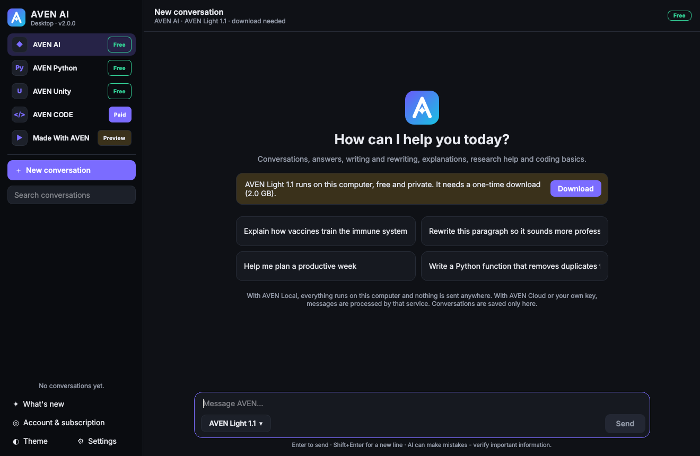
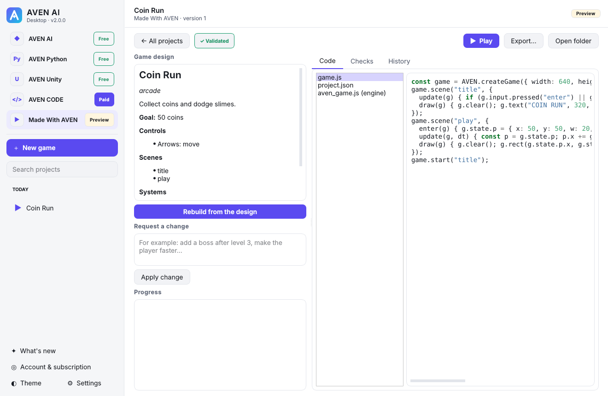

# AVEN AI Desktop

AVEN AI Desktop is a Windows desktop AI app written in Python (PySide6). Version 2.0 has five categories, chosen in the sidebar:

| Category | Access | What it is |
|---|---|---|
| **AVEN AI** | Free | The general assistant: conversations, questions, writing and rewriting, explanations, research help and coding basics. |
| **AVEN Python** | Free | A Python specialist: programs and complete projects, error explanations, refactoring, libraries, desktop apps and automation. Python in replies is checked for syntax errors and undefined names. |
| **AVEN Unity** | Free | A Unity specialist: C# gameplay systems, controllers, UI, physics, scene workflows and Console errors. C# in replies is syntax-checked and checked for common Unity mistakes. |
| **AVEN CODE** | Paid (subscription) | Professional multi-language coding: projects and repositories (attach files or a folder), debugging, refactoring, architecture, reviews. Code in replies is syntax-checked per language. Access is verified by the AVEN Cloud server (Stripe). |
| **Made With AVEN** | Preview (pricing not final; free while in preview) | Describe a game; AVEN designs it, writes it, checks it in a sandbox, repairs problems and lets you play it in the browser. 2D HTML5 games for now. |

Each category has its own instructions, conversation list and remembered model. Every category offers the same four AVEN models: **AVEN 2.0** (the main model), **AVEN Ultra**, **AVEN Core** and **AVEN Light**. All models are free.

Out of the box the app uses **AVEN Local**: open-source AI models running **on the user's own computer**, with **no API key, no account and no cost**. Builds that include an **AVEN Cloud** server address (the AVEN AI server in [`../aven_cloud`](../aven_cloud)) use that server instead, again with no key for users. Advanced users can instead use their own key for **Anthropic (Claude)**, **OpenAI**, or any **OpenAI-compatible server** (including local model servers on `localhost`). The app never makes up responses: if nothing is available, it shows a setup screen.

| AVEN AI (dark theme) | Made With AVEN (light theme) |
|---|---|
|  |  |

*The screenshots were taken in an offscreen test harness, without a downloaded model.*

Version: **2.0.0** (defined in `app/version.py`)

---

## AVEN Local: free, private, on your computer

AVEN Local runs open-source **Qwen** models (Apache-2.0) with the bundled **llama.cpp** engine (`llama-server`, MIT). The first time you pick a model, AVEN offers a **one-time download** from Hugging Face. Each file is pinned to an exact version and checked against its SHA-256 checksum. After that it works offline, and conversations never leave the computer.

| AVEN model | Version | Local model | Download | Notes |
|---|---|---|---|---|
| **AVEN 2.0** (main) | 2.0 | Qwen3.5 9B, answering directly | 5.7 GB | The newest generation; the most capable everyday model. 16 GB of RAM recommended |
| **AVEN Ultra** | 1.0 | Qwen3 8B, with thinking mode | 5.0 GB | Thinks before answering; slower. Unchanged in 2.0 |
| **AVEN Core** | 1.1 | Qwen3.5 4B | 2.7 GB | Balanced; 8 GB of RAM recommended |
| **AVEN Light** | 1.1 | Qwen3.5 2B (8-bit) | 2.0 GB | Fastest; runs on most PCs |

The models, their versions and settings live in [`app/data/models.json`](app/data/models.json): a model can be changed, marked unavailable or "in development", or remapped without changing code.

Some things to know:

- The engine runs on the **CPU**, so speed depends on the PC: a few words per second on older laptops, much faster on modern desktops.
- Every model uses Qwen's recommended sampling settings (different for direct answers and thinking mode), which avoids repetitive or rambling replies.
- It listens only on `127.0.0.1`, with a random per-session access token.
- Models are stored in `%APPDATA%\AVEN AI\models`. Delete them in **Settings → AI Provider → Delete downloaded models**.
- Local models are capable, but less so than large cloud models. For the best answers use AVEN Cloud or your own key.
- Replies stay in the writing systems of the conversation: the engine cannot produce stray Chinese, Korean, Cyrillic, Arabic or Greek words inside a Hebrew or English reply, or Hebrew and English letters glued into one word. Questions about other languages or translations have no such limits.
- Long conversations are fitted to each model's memory using exact token counts. AVEN 2.0 and Ultra use a 16K-token window; replies may use up to 8,192 tokens (for Ultra this includes its thinking).

## Answer quality

Every request carries instructions written for the selected model:

- **Language**: reply in the user's language; natural, correctly spelled Hebrew; code, names and links kept unchanged.
- **Honesty and verification**: AVEN has no web search, file access or code execution in this app, so it says when it cannot check current information (news, prices, weather), asks you to paste files, never claims to have searched or run something, and says so when it does not recognize a book, paper or name instead of inventing details.
- **Reasoning**: for calculations and multi-step problems it works through the steps first and gives the final answer at the end.
- **Style**: friendly and to the point, with an occasional emoji, never inside code.
- **Identity**: today's date, the official model name, and what powers it.

Quality is measured with the evaluation suite in [`evals/`](evals/README.md): real answers from the real models, scored with deterministic checks. See the release notes for the latest before/after numbers.

## AVEN models

Pick the model for each message with the **model picker in the message box**, next to Send. Your choice is remembered.

Cloud mapping (AVEN Cloud with Anthropic, or your own Anthropic key):

| AVEN model | Best for | Model behind it with your own Anthropic key |
|---|---|---|
| **AVEN 2.0** (default) | The smartest everyday AVEN model, for writing, research and code | `claude-opus-5-5` with deeper reasoning (`effort: high`) |
| **AVEN Ultra** | The hardest questions, research and code: thinks longer | `claude-opus-5-5` with extra-deep reasoning (`effort: xhigh`) |
| **AVEN Core** | Balanced speed and quality for everyday work | `claude-sonnet-5-5` |
| **AVEN Light** | The fastest replies for quick questions | `claude-haiku-5-5` |

The chat interface only shows AVEN names.

- **With AVEN Cloud**, the server picks the models. It can run on a **free** service such as Groq or Google Gemini, or on Anthropic; see [`aven_cloud/README.md`](../aven_cloud/README.md). You can change this without shipping a new app.
- **With your own key**, the mapping is in **Settings → AI Provider → Advanced**. OpenAI and compatible servers have no default mapping.

AVEN AI does not train its own model. Settings and the privacy notice state who processes conversations, and the assistant answers truthfully if asked what powers it.

## Features

- **Five categories** in the sidebar with **Free**, **Paid** and **Preview** badges; each keeps its own conversations and model. `Ctrl+1` … `Ctrl+5` switch categories.
- **Model picker** in the message box with each model's version and download size.
- **Coding tools** (AVEN Python, AVEN Unity, AVEN CODE): attach files or a whole project folder (text files only, size-limited, build folders skipped); **code checks** under each reply (tree-sitter syntax checks for C#, JavaScript, TypeScript, Java, C++, HTML and CSS; Python syntax and pyflakes; Unity rules). Nothing is ever run. **Save files…** writes the files a reply names into a folder you choose, refusing absolute paths, `..` and reserved names.
- **Made With AVEN**: a dashboard of game projects, a design plan, progress log, code and checks viewers, change requests, version history, **Play** (opens the game in your browser), **Export** (.zip) and **Open folder**. See below.
- **What's New** after each update, and any time from the sidebar.
- **Account & subscription** for AVEN CODE (see below).
- **Streamed responses**, with a *thinking…* indicator, a **Stop** button (or `Esc`), **Retry** after errors and **Regenerate**
- **Markdown** rendering (with right-to-left layout for Hebrew), **code blocks** with syntax highlighting and **Copy code**
- **Local history** in SQLite: create, rename, delete, search, load earlier messages on demand, delete everything
- **Settings**: theme, provider, API key, the provider model behind each AVEN model, connection test, max response length and timeout
- **Clear errors** for a missing or invalid key, unknown models, rate limits, timeouts, network failures, provider outages, declined requests and missing subscriptions
- The window stays responsive: network calls, model work and game checks run on background threads

## Made With AVEN

Describe a game in plain words. The pipeline then:

1. **Designs** it: a JSON plan with the genre, controls, systems, characters, scenes, goal, and what was simplified (shown in the workspace).
2. **Writes** `game.js` on the bundled **AVEN game engine** (a small 2D canvas engine: scenes, input, camera, drawing, collisions, sounds), drawing everything with shapes and text.
3. **Checks** it: JavaScript syntax (tree-sitter), safety rules (no network, no `eval`, no imports, no external files), and a **sandboxed test run**: the game runs for 300 frames in QuickJS (no file, network or process access; memory and time limits) while simulated keys are pressed. Crashes, games that never start and games that draw nothing are caught.
4. **Repairs** problems: the errors go back to the model, up to three times.
5. Marks the version **Validated** only if every check passed; otherwise **Needs fixes**, with the errors shown.

**Play** opens the game in your web browser from a single self-contained `index.html`. A Content-Security-Policy allows only the page's own two scripts (by SHA-256 hash) and blocks every network request, so a generated game cannot load or send anything. Projects, every version and their history are saved in the AVEN AI data folder; request changes at any time, and **Export** a .zip to share.

Honest limits: games are 2D; a big request (an open world with vehicles and missions) becomes a smaller playable 2D version and the plan says what was simplified. The checks catch crashes, not every bug or design problem, so play the result. On-device models are much slower at writing a whole game than cloud models (several minutes to tens of minutes on a CPU).

## AVEN CODE subscription

AVEN CODE is the paid category. The app never decides on its own that it is paid for:

- Checkout and subscription management open **Stripe's own pages** in your browser, created by the AVEN Cloud server. The app never sees card details or Stripe keys.
- The server records subscriptions only from **signature-verified Stripe webhooks** and re-reads their state from Stripe. Failed payments, cancellations and expired periods remove access.
- Requests through **AVEN Cloud** are checked by the server on every message.
- For AVEN Local or a personal key, the app unlocks AVEN CODE only with an **entitlement signed by the server** (Ed25519, valid for up to 24 hours, never beyond the paid period), checked against the account and the server's public key built into the app.

AVEN CODE needs a deployed AVEN Cloud server with Stripe configured (see [`aven_cloud/README.md`](../aven_cloud/README.md)) and a build made with `AVEN_CLOUD_URL` and `AVEN_ENTITLEMENT_PUBLIC_KEY`. Until then the category is shown with a clear "not available in this build yet" message, and nothing is unlocked. The price is set in Stripe and shown as Stripe reports it.

Limitation: when AVEN CODE runs on your own computer (AVEN Local or a personal key), the check runs on that computer. It stops casual unlocking, but someone who modifies the application could bypass it; only requests through AVEN Cloud are enforced by the server.

## Requirements

- Windows 11 (Windows 10 should also work, but Windows 11 is the main target)
- **End users** of a packaged release don't need anything else. Python is bundled.
- **Developers** need Python 3.11+ (3.12 recommended for Windows builds)
- An account and API key with a supported AI provider. A local OpenAI-compatible server needs no key.

## Running from source

```powershell
cd aven_ai_desktop
py -3.12 -m venv .venv
.venv\Scripts\activate
pip install -r requirements.txt
python main.py
```

On macOS or Linux the steps are the same (`python3 -m venv .venv && source .venv/bin/activate`). The app runs there too, but Windows is the release target.

## Configuring an AI provider

### AVEN Cloud (default, no API key)

When the app is built with an AVEN Cloud server address, people just install it and chat. There's nothing to configure. To set this up:

1. Deploy the server. A free setup (Groq + Render) is described in [`aven_cloud/README.md`](../aven_cloud/README.md).
2. Set the GitHub Actions variable `AVEN_CLOUD_URL`, or the environment variable of the same name for local builds.
3. Rebuild. The address is written into `assets/cloud.json`. It is public and contains no secrets.

The app sends a random install ID with each request so the server can enforce fair-use limits. No API key is ever stored in the app.

If a build has no server address, the app says so and asks for a personal key instead.

### Your own API key (optional)

Open **Settings → AI Provider**, then:

1. Pick **Anthropic (Claude)** or **OpenAI / OpenAI-compatible**.
2. Paste your **API key**.
   - Anthropic keys come from the Claude Console: <https://platform.claude.com/>
   - OpenAI keys come from <https://platform.openai.com/>
3. Check the **Advanced** mapping, which sets the provider model behind each AVEN model.
   - Anthropic comes pre-mapped.
   - For OpenAI, type model IDs or click **Load available models**.
4. Click **Test connection**. This sends one short real request with the selected AVEN model and shows either the reply or the exact error.
5. Click **Save**.

### OpenAI-compatible and local servers

Choose *OpenAI / OpenAI-compatible* and set a **Base URL**, for example `http://localhost:11434/v1`. Plain `http://` is only allowed for `localhost`. Every other address must use `https://`. Local servers don't need an API key.

### Environment variables (development)

When you run from source, you can put a `.env` file next to `main.py` (see `.env.example`) or set these variables:

| Variable | Purpose |
|---|---|
| `ANTHROPIC_API_KEY` / `OPENAI_API_KEY` | API key. Takes precedence over a key saved in Settings. |
| `AVEN_PROVIDER` | `aven_local`, `aven_cloud`, `anthropic` or `openai` |
| `AVEN_LLAMA_SERVER` | Path to a `llama-server` binary (development; packaged builds bundle one) |
| `AVEN_CLOUD_URL` | AVEN Cloud server address, for example `http://localhost:8000` when testing |
| `AVEN_MODEL` | Selected AVEN model: `aven-1-1`, `aven-ultra`, `aven-core` or `aven-light` |
| `AVEN_1_1_MODEL` / `AVEN_ULTRA_MODEL` / `AVEN_CORE_MODEL` / `AVEN_LIGHT_MODEL` | Provider model ID behind each AVEN model (personal-key providers) |
| `AVEN_BASE_URL` | Base URL for an OpenAI-compatible server |
| `AVEN_DATA_DIR` | Use a different data folder |

Packaged builds read real environment variables, but they never read `.env` files.

### How API keys are stored, and the limits of that

- A key entered in Settings goes to the **Windows Credential Manager** through the `keyring` library. On other systems it goes to the system credential store.
- Keys are **never** written to the settings file, the database or the logs. The logs also mask anything that looks like a key.
- **Limitation:** Credential Manager protects a key with your Windows sign-in. That keeps it away from other user accounts and from accidental disclosure, but **any program running under your own user account can read it**. Treat your API key like a password, set a spending limit in your provider's console, and revoke the key if you suspect your PC is compromised.
- If no credential store is available, the key is only kept in memory until you close the app. Use the environment variable instead.
- **Developers:** never put your own API key into the source code or the packaged app. Anyone can extract it from an `.exe`. To let people chat without a key, use AVEN Cloud, which keeps the key on your server.

## Privacy and your data

**What leaves your computer.** With **AVEN Local**, nothing: the model runs on your PC. The only network traffic is the one-time model download from Hugging Face. With the other providers, AVEN sends the conversation so far, plus the mode's instructions, over HTTPS:

- **With AVEN Cloud**, it goes to the AVEN AI server, which forwards it to the AI service the server runs on (for example Groq, Google Gemini or Anthropic). A random install ID goes along with it, used only for fair-use limits. Free AI services may use the content they receive under their own terms.
- **With your own key**, it goes directly to the provider you selected.

Providers process messages under their own terms and privacy policies ([Anthropic](https://www.anthropic.com/legal/privacy), [OpenAI](https://openai.com/policies/privacy-policy)). AVEN AI Desktop has no telemetry or analytics, and it does not upload files or conversations anywhere else.

**What stays on your computer.**

| Item | Location (Windows) |
|---|---|
| Conversations (SQLite) | `%APPDATA%\AVEN AI\conversations.db` |
| Settings (no secrets) | `%APPDATA%\AVEN AI\settings.json` |
| Logs (events and errors, no message contents) | `%APPDATA%\AVEN AI\logs\` |
| API key | Windows Credential Manager, entry “AVEN AI Desktop” |
| AVEN Local models | `%APPDATA%\AVEN AI\models\` |

On macOS the data folder is `~/Library/Application Support/AVEN AI`. On Linux it is `~/.local/share/aven-ai`.

The data folder is separate from the installation folder, so **updating or reinstalling the app keeps your conversations**.

**Deleting data:**

- One conversation: right-click it in the sidebar and choose **Delete**.
- Everything: **Settings → Privacy & Data → Delete all conversations…**
- Full removal: quit the app, delete the `%APPDATA%\AVEN AI` folder, and remove the key in Settings (**Remove saved key**) or in Windows Credential Manager.

Data you already sent to a provider is subject to that provider's retention policy. Deleting it locally doesn't delete it there.

### Other safety measures

- The app never renders raw HTML from AI output. Only `http`, `https` and `mailto` links are kept, and clicking one shows the full URL and asks before opening your browser. Images are never loaded.
- AI-generated code is **never executed**. AVEN CODE's instructions also forbid claiming that code was run or tested.
- Input length is limited, model IDs and base URLs are validated, and every provider error is converted into a safe message.

## Keyboard shortcuts

| Shortcut | Action |
|---|---|
| `Enter` | Send. This can be changed to `Ctrl+Enter` in Settings. |
| `Shift+Enter` | New line |
| `Esc` | Stop generating |
| `Ctrl+N` | New conversation |
| `Ctrl+1` / `Ctrl+2` | Switch to AVEN / AVEN CODE |
| `Ctrl+L` | Focus the message box |
| `Ctrl+,` | Settings |

## Tests and static checks

```powershell
pip install -r requirements-dev.txt
$env:QT_QPA_PLATFORM="offscreen"   # optional: run UI tests without showing windows
python -m pytest -q
ruff check .
```

The tests never need a real API key and never touch the network. Provider tests drive the real `anthropic` and `openai` SDKs against a mocked HTTP transport that returns streaming responses in each provider's format. UI tests (pytest-qt) use a fake provider.

## Building the Windows executable

The build script also downloads the pinned llama.cpp engine (`scripts/fetch_engine.py`, checksum-verified) and bundles it for AVEN Local. Models are **not** bundled: users download only the ones they choose.


The build has to run **on Windows**. PyInstaller cannot cross-compile.

```powershell
cd aven_ai_desktop
powershell -ExecutionPolicy Bypass -File scripts\build_windows.ps1
```

The script:

1. Creates `.venv-build`.
2. Installs `requirements-dev.txt`.
3. Runs the tests.
4. Regenerates `assets\aven.ico` from the vector logo.
5. Runs PyInstaller with `aven_ai.spec`.

Output:

| Build | Path |
|---|---|
| **Installer (`-Installer`, recommended for download)** | `dist\AVEN-AI-Setup-<version>.exe`: per-user install, no admin rights, Start menu shortcut, normal uninstall |
| Folder build (portable) | `dist\AVEN AI\AVEN AI.exe`, plus `dist\AVEN-AI-Desktop-<version>-win64.zip` |
| Single file (`-OneFile`) | `dist\AVEN AI.exe`. Not recommended: antivirus products flag self-extracting single files most often |

The folder build starts faster and antivirus heuristics flag it less often than a self-extracting single file. Distribute the **whole** `AVEN AI` folder (or the zip). The executable is windowed, so no console opens. It carries Windows version information and the AVEN icon, and it bundles the Python runtime.

Script options: `-Installer`, `-BuildBootloader`, `-OneFile`, `-SkipTests`, `-Python "py -3.13"`.

### Download safety

Two different warnings can appear for a new Windows app:

1. **Antivirus false positives.** Apps packaged with PyInstaller are often flagged because malware uses the same pre-built launcher. The release build therefore:
   - compiles PyInstaller's launcher from source (`-BuildBootloader`)
   - ships an installer instead of a self-extracting single file
   - is scanned with Microsoft Defender in CI, and the build fails on any detection

   If an antivirus product still flags a release, report it as a false positive. For Microsoft, use <https://www.microsoft.com/wdsi/filesubmission>.
2. **"Windows protected your PC" (SmartScreen).** This appears for software that is **not code-signed**. Only a code-signing certificate removes it; see section 5 of [RELEASE_CHECKLIST.md](RELEASE_CHECKLIST.md), including **free signing for open-source projects**. Once the certificate is added as two repository secrets, the build signs everything automatically.

Publish the SHA-256 checksums (`SHA256SUMS.txt`) next to the download so people can verify their copy.

See [RELEASE_CHECKLIST.md](RELEASE_CHECKLIST.md) before publishing a build.

### Runtime dependencies

| Package | Why |
|---|---|
| `PySide6-Essentials` | Qt GUI. Only the essentials, not WebEngine, to keep the bundle small. |
| `anthropic` | Official Anthropic SDK |
| `openai` | Official OpenAI SDK (also used for OpenAI-compatible servers) |
| `keyring` | Windows Credential Manager access |
| `Markdown` | Markdown → HTML, with raw HTML disabled |
| `Pygments` | Syntax highlighting |

## Project structure

```
aven_ai_desktop/
├── main.py                      # entry point, startup error reporting
├── aven_ai.spec                 # PyInstaller build definition
├── requirements.txt / requirements-dev.txt / pyproject.toml
├── .env.example                 # development configuration template
├── assets/                      # aven.ico, aven.png (generated from the vector logo)
├── scripts/
│   ├── build_windows.ps1        # reproducible Windows build
│   └── generate_icon.py         # renders the logo into a multi-size .ico
├── app/
│   ├── version.py               # app name and version (single source of truth)
│   ├── selftest.py              # --self-test: verifies every bundled 2.0 component
│   ├── data/                    # catalog: models.json, categories.json, releases.json (What's New)
│   ├── account/                 # AVEN AI account, server-signed entitlements (paid categories)
│   ├── code/                    # code blocks, static checks, attaching and saving files
│   ├── studio/                  # Made With AVEN: engine + sandbox (runtime/), pipeline, checks, projects
│   ├── paths.py                 # per-user data dir, bundled resource paths
│   ├── logging_setup.py         # rotating log file with secret redaction
│   ├── application.py           # bootstrap: services, theme, main window
│   ├── config/
│   │   ├── aven_models.py       # model lineup API (from the catalog), legacy ids, mappings
│   │   ├── catalog.py           # loads and validates app/data/*.json
│   │   ├── cloud.py             # AVEN Cloud server address (env var or assets/cloud.json)
│   │   ├── settings.py          # settings model, JSON persistence, env overrides
│   │   └── secrets.py           # API keys: env var → credential store → session
│   ├── ai/
│   │   ├── base_provider.py     # provider interface, ChatRequest, StreamEvent
│   │   ├── anthropic_provider.py
│   │   ├── openai_provider.py
│   │   ├── provider_factory.py  # provider registry and construction
│   │   ├── chat_service.py      # config status, request building, history trimming
│   │   ├── prompts.py           # system instructions per category and AVEN model
│   │   └── errors.py            # user-facing error types
│   ├── storage/
│   │   ├── database.py          # SQLite connection and migrations
│   │   └── conversation_repository.py
│   ├── rendering/
│   │   └── markdown_renderer.py # safe Markdown, code segmentation, highlighting
│   ├── local/                   # AVEN Local: model catalog, verified downloader, llama-server engine,
│   │                            #   script guard (keeps replies in the conversation's writing systems)
│   ├── workers/
│   │   └── ai_worker.py         # background streaming and task threads
│   └── ui/
│       ├── main_window.py       # window and conversation controller
│       ├── sidebar.py
│       ├── chat_view.py         # header, mode switch, welcome, messages, composer
│       ├── message_widget.py    # message bubbles, code blocks, error card
│       ├── settings_dialog.py
│       ├── theme_manager.py     # light and dark palettes, stylesheet
│       └── logo.py              # vector-drawn AVEN logo
├── evals/                       # answer-quality evaluation with real models (see evals/README.md)
└── tests/                       # pytest + pytest-qt
```

## Troubleshooting

| Problem | What to do |
|---|---|
| AVEN Local replies are slow | Use AVEN Light, close other heavy programs, or use AVEN Cloud or your own key. |
| “The local AI engine stopped while loading the model” | Not enough free memory for that model. Use AVEN Light or AVEN Core. |
| Model download fails or stops | Click **Try again**: downloads resume where they stopped. A corporate firewall may block huggingface.co. |
| “AVEN Cloud is not available in this build yet” | The build was made without `AVEN_CLOUD_URL`. Deploy AVEN Cloud and rebuild, or add your own key in Settings → AI Provider. |
| “You've reached today's free message limit” | AVEN Cloud's fair-use limit. Try again tomorrow, or use your own API key. |
| “AI provider not configured” | Add an API key in Settings → AI Provider, or set `ANTHROPIC_API_KEY` / `OPENAI_API_KEY`. |
| “Invalid API key” | Copy the key again from the provider console. Check whether an environment variable is overriding the saved key; Settings shows where the key comes from. |
| “Model not available” | Your account may not have access to the model behind that AVEN model. In Settings → AI Provider → Advanced, click **Load available models** and pick one. |
| “AVEN Ultra is not set up for this provider yet” | Set its provider model ID under Settings → AI Provider → Advanced. |
| “Rate limit reached” | Wait and retry. Check your plan's limits and billing in the provider console. |
| “Request timed out” / “Connection problem” | Check your internet connection, proxy or firewall. Long answers may need a larger timeout in Settings. |
| Answer ends with “reached the maximum length” | Increase **Max response tokens** in Settings. |
| Windows SmartScreen warning | The build is not code-signed. Choose *More info → Run anyway*, or sign the build (see the release checklist). |
| The app does not start | See `%APPDATA%\AVEN AI\logs\startup-error.log` and `aven.log`. |
| Corrupted settings | Delete `%APPDATA%\AVEN AI\settings.json`. Defaults are restored and conversations are unaffected. |

## Current limitations

- No image attachments, web search or browsing. Text files can be attached in the coding categories. AVEN says when it cannot check current information.
- Code in replies is checked statically (syntax and common mistakes); it is never run, so tests and builds must be run by you. There is no C# compiler or Unity in the checks.
- The on-device models are small. AVEN Light in particular still makes factual and Hebrew mistakes; AVEN 2.0 or Ultra are much more reliable.
- Made With AVEN builds 2D browser games; there is no 3D engine and no image or sound generation yet.
- AVEN CODE needs a deployed AVEN Cloud server with Stripe; AVEN AI accounts are anonymous and tied to one computer (no sign-in to move a subscription yet).
- Responses come from one provider at a time: AVEN Cloud, Anthropic, or OpenAI (or OpenAI-compatible).
- AVEN Cloud needs a deployed server and a key for an AI service. Free tiers (Groq, Gemini) cost nothing, but their limits are shared by all users of the server.
- There is no automatic update system. Install new versions over the old one; your data folder is kept.
- Release builds are not code-signed unless you sign them yourself.
- Very long conversations send at most about the last 400,000 characters of history to the provider. All messages stay in the local database.
