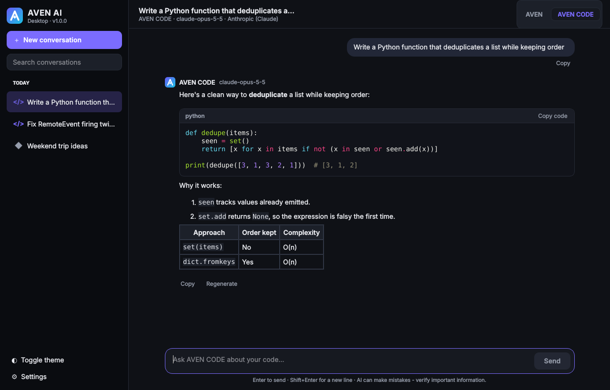
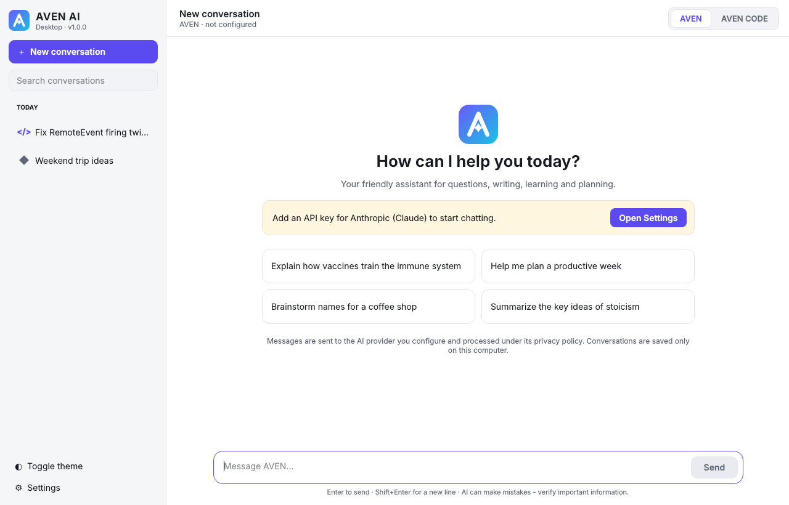

# AVEN AI Desktop

AVEN AI Desktop is a Windows desktop AI app written in Python (PySide6). It has two modes:

- **AVEN** is a friendly general-purpose assistant for questions, explanations, brainstorming, writing, summaries, learning, planning and everyday problem-solving.
- **AVEN CODE** is a programming assistant for writing, debugging, explaining, refactoring and reviewing code. It knows Python, JavaScript/TypeScript, HTML/CSS, Roblox Luau, Unity C#, Unreal Engine C++, Java, C#, SQL and more.

Out of the box the app uses **AVEN Local**: open-source AI models running **on the user's own computer**, with **no API key, no account and no cost**. Builds that include an **AVEN Cloud** server address (the AVEN AI server in [`../aven_cloud`](../aven_cloud)) use that server instead, again with no key for users. Advanced users can instead use their own key for **Anthropic (Claude)**, **OpenAI**, or any **OpenAI-compatible server** (including local model servers on `localhost`). The app never makes up responses: if nothing is available, it shows a setup screen.

| Dark theme, AVEN CODE | Light theme, first launch |
|---|---|
|  |  |

*The screenshots were taken with a mock provider in an offscreen test harness.*

Version: **1.0.0** (defined in `app/version.py`)

---

## AVEN Local: free, private, on your computer

AVEN Local runs open-source **Qwen3** models (Apache-2.0) with the bundled **llama.cpp** engine (`llama-server`, MIT). The first time you pick a model, AVEN offers a **one-time download** from Hugging Face. Each file is pinned to an exact version and checked against its SHA-256 checksum. After that it works offline, and conversations never leave the computer.

| AVEN model | Local model | Download | Notes |
|---|---|---|---|
| **AVEN Light** (default) | Qwen3 1.7B | 1.3 GB | Fastest; runs on almost any PC |
| **AVEN Core** | Qwen3 4B | 2.5 GB | Smarter; 8 GB of RAM recommended |
| **AVEN 1.0** | Qwen3 4B, with thinking mode | same file as Core | Reasons before answering: better, slower |
| **AVEN Ultra** | Qwen3 8B, with thinking mode | 5.0 GB | Smartest locally; 16 GB of RAM recommended, slow on older PCs |

Some things to know:

- The engine runs on the **CPU**, so speed depends on the PC: a few words per second on older laptops, much faster on modern desktops.
- It listens only on `127.0.0.1`, with a random per-session access token.
- Models are stored in `%APPDATA%\AVEN AI\models`. Delete them in **Settings → AI Provider → Delete downloaded models**.
- Local models are capable, but less so than large cloud models. For the best answers use AVEN Cloud or your own key.

## AVEN models

Pick the model for each message with the **model picker in the message box**, next to Send. Your choice is remembered.

Cloud mapping (AVEN Cloud with Anthropic, or your own Anthropic key):

| AVEN model | Best for | Model behind it with your own Anthropic key |
|---|---|---|
| **AVEN 1.0** (default) | The main AVEN model: smart and reliable for everything | `claude-opus-5-5` |
| **AVEN Ultra** | The hardest questions, research and code: thinks longer | `claude-opus-5-5` with extra-deep reasoning (`effort: xhigh`) |
| **AVEN Core** | Balanced speed and quality for everyday work | `claude-sonnet-5-5` |
| **AVEN Light** | The fastest replies for quick questions | `claude-haiku-5-5` |

The chat interface only shows AVEN names.

- **With AVEN Cloud**, the server picks the models. It can run on a **free** service such as Groq or Google Gemini, or on Anthropic; see [`aven_cloud/README.md`](../aven_cloud/README.md). You can change this without shipping a new app.
- **With your own key**, the mapping is in **Settings → AI Provider → Advanced**. OpenAI and compatible servers have no default mapping.

AVEN AI does not train its own model. Settings and the privacy notice state who processes conversations, and the assistant answers truthfully if asked what powers it.

## Features

- Sidebar with branding, a **New conversation** button, search, and history grouped by date (Today, Yesterday, …)
- Each conversation has its own **mode**. You can switch modes from the header at any time; the system instructions change from the next reply.
- **Streamed responses**, with a *thinking…* indicator, a **Stop** button (or `Esc`), **Retry** after errors and **Regenerate**
- **Markdown** rendering: headings, lists, tables, links and inline code
- **Code blocks** with syntax highlighting (Pygments) and a **Copy code** button. You can also copy whole messages.
- **Local history** in SQLite: create, rename, delete, load earlier messages on demand in long conversations, and delete everything
- **Settings**: theme (match Windows / light / dark), the AVEN model for each mode, provider, API key, the provider model behind each AVEN model, loading the list of models your key can use, a real **connection test**, max response length and timeout
- **Clear errors** for a missing or invalid key, unknown models, rate limits, timeouts, network failures, provider outages and declined requests
- The window stays responsive: network calls run on background threads and streamed text is batched for rendering

## Requirements

- Windows 11 (Windows 10 should also work, but Windows 11 is the main target)
- **End users** of a packaged release don't need anything else. Python is bundled.
- **Developers** need Python 3.11+ (3.12 recommended for Windows builds)
- An account and API key with a supported AI provider. A local OpenAI-compatible server needs no key.

## Running from source

```powershell
cd aven_ai_desktop
py -3.12 -m venv .venv
.venv\Scripts\activate
pip install -r requirements.txt
python main.py
```

On macOS or Linux the steps are the same (`python3 -m venv .venv && source .venv/bin/activate`). The app runs there too, but Windows is the release target.

## Configuring an AI provider

### AVEN Cloud (default, no API key)

When the app is built with an AVEN Cloud server address, people just install it and chat. There's nothing to configure. To set this up:

1. Deploy the server. A free setup (Groq + Render) is described in [`aven_cloud/README.md`](../aven_cloud/README.md).
2. Set the GitHub Actions variable `AVEN_CLOUD_URL`, or the environment variable of the same name for local builds.
3. Rebuild. The address is written into `assets/cloud.json`. It is public and contains no secrets.

The app sends a random install ID with each request so the server can enforce fair-use limits. No API key is ever stored in the app.

If a build has no server address, the app says so and asks for a personal key instead.

### Your own API key (optional)

Open **Settings → AI Provider**, then:

1. Pick **Anthropic (Claude)** or **OpenAI / OpenAI-compatible**.
2. Paste your **API key**.
   - Anthropic keys come from the Claude Console: <https://platform.claude.com/>
   - OpenAI keys come from <https://platform.openai.com/>
3. Check the **Advanced** mapping, which sets the provider model behind each AVEN model.
   - Anthropic comes pre-mapped.
   - For OpenAI, type model IDs or click **Load available models**.
4. Click **Test connection**. This sends one short real request with the selected AVEN model and shows either the reply or the exact error.
5. Click **Save**.

### OpenAI-compatible and local servers

Choose *OpenAI / OpenAI-compatible* and set a **Base URL**, for example `http://localhost:11434/v1`. Plain `http://` is only allowed for `localhost`. Every other address must use `https://`. Local servers don't need an API key.

### Environment variables (development)

When you run from source, you can put a `.env` file next to `main.py` (see `.env.example`) or set these variables:

| Variable | Purpose |
|---|---|
| `ANTHROPIC_API_KEY` / `OPENAI_API_KEY` | API key. Takes precedence over a key saved in Settings. |
| `AVEN_PROVIDER` | `aven_local`, `aven_cloud`, `anthropic` or `openai` |
| `AVEN_LLAMA_SERVER` | Path to a `llama-server` binary (development; packaged builds bundle one) |
| `AVEN_CLOUD_URL` | AVEN Cloud server address, for example `http://localhost:8000` when testing |
| `AVEN_MODEL` | Selected AVEN model: `aven-1`, `aven-ultra`, `aven-core` or `aven-light` |
| `AVEN_1_MODEL` / `AVEN_ULTRA_MODEL` / `AVEN_CORE_MODEL` / `AVEN_LIGHT_MODEL` | Provider model ID behind each AVEN model (personal-key providers) |
| `AVEN_BASE_URL` | Base URL for an OpenAI-compatible server |
| `AVEN_DATA_DIR` | Use a different data folder |

Packaged builds read real environment variables, but they never read `.env` files.

### How API keys are stored, and the limits of that

- A key entered in Settings goes to the **Windows Credential Manager** through the `keyring` library. On other systems it goes to the system credential store.
- Keys are **never** written to the settings file, the database or the logs. The logs also mask anything that looks like a key.
- **Limitation:** Credential Manager protects a key with your Windows sign-in. That keeps it away from other user accounts and from accidental disclosure, but **any program running under your own user account can read it**. Treat your API key like a password, set a spending limit in your provider's console, and revoke the key if you suspect your PC is compromised.
- If no credential store is available, the key is only kept in memory until you close the app. Use the environment variable instead.
- **Developers:** never put your own API key into the source code or the packaged app. Anyone can extract it from an `.exe`. To let people chat without a key, use AVEN Cloud, which keeps the key on your server.

## Privacy and your data

**What leaves your computer.** With **AVEN Local**, nothing: the model runs on your PC. The only network traffic is the one-time model download from Hugging Face. With the other providers, AVEN sends the conversation so far, plus the mode's instructions, over HTTPS:

- **With AVEN Cloud**, it goes to the AVEN AI server, which forwards it to the AI service the server runs on (for example Groq, Google Gemini or Anthropic). A random install ID goes along with it, used only for fair-use limits. Free AI services may use the content they receive under their own terms.
- **With your own key**, it goes directly to the provider you selected.

Providers process messages under their own terms and privacy policies ([Anthropic](https://www.anthropic.com/legal/privacy), [OpenAI](https://openai.com/policies/privacy-policy)). AVEN AI Desktop has no telemetry or analytics, and it does not upload files or conversations anywhere else.

**What stays on your computer.**

| Item | Location (Windows) |
|---|---|
| Conversations (SQLite) | `%APPDATA%\AVEN AI\conversations.db` |
| Settings (no secrets) | `%APPDATA%\AVEN AI\settings.json` |
| Logs (events and errors, no message contents) | `%APPDATA%\AVEN AI\logs\` |
| API key | Windows Credential Manager, entry “AVEN AI Desktop” |
| AVEN Local models | `%APPDATA%\AVEN AI\models\` |

On macOS the data folder is `~/Library/Application Support/AVEN AI`. On Linux it is `~/.local/share/aven-ai`.

The data folder is separate from the installation folder, so **updating or reinstalling the app keeps your conversations**.

**Deleting data:**

- One conversation: right-click it in the sidebar and choose **Delete**.
- Everything: **Settings → Privacy & Data → Delete all conversations…**
- Full removal: quit the app, delete the `%APPDATA%\AVEN AI` folder, and remove the key in Settings (**Remove saved key**) or in Windows Credential Manager.

Data you already sent to a provider is subject to that provider's retention policy. Deleting it locally doesn't delete it there.

### Other safety measures

- The app never renders raw HTML from AI output. Only `http`, `https` and `mailto` links are kept, and clicking one shows the full URL and asks before opening your browser. Images are never loaded.
- AI-generated code is **never executed**. AVEN CODE's instructions also forbid claiming that code was run or tested.
- Input length is limited, model IDs and base URLs are validated, and every provider error is converted into a safe message.

## Keyboard shortcuts

| Shortcut | Action |
|---|---|
| `Enter` | Send. This can be changed to `Ctrl+Enter` in Settings. |
| `Shift+Enter` | New line |
| `Esc` | Stop generating |
| `Ctrl+N` | New conversation |
| `Ctrl+1` / `Ctrl+2` | Switch to AVEN / AVEN CODE |
| `Ctrl+L` | Focus the message box |
| `Ctrl+,` | Settings |

## Tests and static checks

```powershell
pip install -r requirements-dev.txt
$env:QT_QPA_PLATFORM="offscreen"   # optional: run UI tests without showing windows
python -m pytest -q
ruff check .
```

The tests never need a real API key and never touch the network. Provider tests drive the real `anthropic` and `openai` SDKs against a mocked HTTP transport that returns streaming responses in each provider's format. UI tests (pytest-qt) use a fake provider.

## Building the Windows executable

The build script also downloads the pinned llama.cpp engine (`scripts/fetch_engine.py`, checksum-verified) and bundles it for AVEN Local. Models are **not** bundled: users download only the ones they choose.


The build has to run **on Windows**. PyInstaller cannot cross-compile.

```powershell
cd aven_ai_desktop
powershell -ExecutionPolicy Bypass -File scripts\build_windows.ps1
```

The script:

1. Creates `.venv-build`.
2. Installs `requirements-dev.txt`.
3. Runs the tests.
4. Regenerates `assets\aven.ico` from the vector logo.
5. Runs PyInstaller with `aven_ai.spec`.

Output:

| Build | Path |
|---|---|
| **Installer (`-Installer`, recommended for download)** | `dist\AVEN-AI-Setup-<version>.exe`: per-user install, no admin rights, Start menu shortcut, normal uninstall |
| Folder build (portable) | `dist\AVEN AI\AVEN AI.exe`, plus `dist\AVEN-AI-Desktop-<version>-win64.zip` |
| Single file (`-OneFile`) | `dist\AVEN AI.exe`. Not recommended: antivirus products flag self-extracting single files most often |

The folder build starts faster and antivirus heuristics flag it less often than a self-extracting single file. Distribute the **whole** `AVEN AI` folder (or the zip). The executable is windowed, so no console opens. It carries Windows version information and the AVEN icon, and it bundles the Python runtime.

Script options: `-Installer`, `-BuildBootloader`, `-OneFile`, `-SkipTests`, `-Python "py -3.13"`.

### Download safety

Two different warnings can appear for a new Windows app:

1. **Antivirus false positives.** Apps packaged with PyInstaller are often flagged because malware uses the same pre-built launcher. The release build therefore:
   - compiles PyInstaller's launcher from source (`-BuildBootloader`)
   - ships an installer instead of a self-extracting single file
   - is scanned with Microsoft Defender in CI, and the build fails on any detection

   If an antivirus product still flags a release, report it as a false positive. For Microsoft, use <https://www.microsoft.com/wdsi/filesubmission>.
2. **"Windows protected your PC" (SmartScreen).** This appears for software that is **not code-signed**. Only a code-signing certificate removes it; see section 5 of [RELEASE_CHECKLIST.md](RELEASE_CHECKLIST.md), including **free signing for open-source projects**. Once the certificate is added as two repository secrets, the build signs everything automatically.

Publish the SHA-256 checksums (`SHA256SUMS.txt`) next to the download so people can verify their copy.

See [RELEASE_CHECKLIST.md](RELEASE_CHECKLIST.md) before publishing a build.

### Runtime dependencies

| Package | Why |
|---|---|
| `PySide6-Essentials` | Qt GUI. Only the essentials, not WebEngine, to keep the bundle small. |
| `anthropic` | Official Anthropic SDK |
| `openai` | Official OpenAI SDK (also used for OpenAI-compatible servers) |
| `keyring` | Windows Credential Manager access |
| `Markdown` | Markdown → HTML, with raw HTML disabled |
| `Pygments` | Syntax highlighting |

## Project structure

```
aven_ai_desktop/
├── main.py                      # entry point, startup error reporting
├── aven_ai.spec                 # PyInstaller build definition
├── requirements.txt / requirements-dev.txt / pyproject.toml
├── .env.example                 # development configuration template
├── assets/                      # aven.ico, aven.png (generated from the vector logo)
├── scripts/
│   ├── build_windows.ps1        # reproducible Windows build
│   └── generate_icon.py         # renders the logo into a multi-size .ico
├── app/
│   ├── version.py               # app name and version (single source of truth)
│   ├── paths.py                 # per-user data dir, bundled resource paths
│   ├── logging_setup.py         # rotating log file with secret redaction
│   ├── application.py           # bootstrap: services, theme, main window
│   ├── config/
│   │   ├── aven_models.py       # AVEN 1.0 / Ultra / Core / Light and default mappings
│   │   ├── cloud.py             # AVEN Cloud server address (env var or assets/cloud.json)
│   │   ├── settings.py          # settings model, JSON persistence, env overrides
│   │   └── secrets.py           # API keys: env var → credential store → session
│   ├── ai/
│   │   ├── base_provider.py     # provider interface, ChatRequest, StreamEvent
│   │   ├── anthropic_provider.py
│   │   ├── openai_provider.py
│   │   ├── provider_factory.py  # provider registry and construction
│   │   ├── chat_service.py      # config status, request building, history trimming
│   │   ├── prompts.py           # AVEN and AVEN CODE system instructions
│   │   └── errors.py            # user-facing error types
│   ├── storage/
│   │   ├── database.py          # SQLite connection and migrations
│   │   └── conversation_repository.py
│   ├── rendering/
│   │   └── markdown_renderer.py # safe Markdown, code segmentation, highlighting
│   ├── local/                   # AVEN Local: model catalog, verified downloader, llama-server engine
│   ├── workers/
│   │   └── ai_worker.py         # background streaming and task threads
│   └── ui/
│       ├── main_window.py       # window and conversation controller
│       ├── sidebar.py
│       ├── chat_view.py         # header, mode switch, welcome, messages, composer
│       ├── message_widget.py    # message bubbles, code blocks, error card
│       ├── settings_dialog.py
│       ├── theme_manager.py     # light and dark palettes, stylesheet
│       └── logo.py              # vector-drawn AVEN logo
└── tests/                       # pytest + pytest-qt
```

## Troubleshooting

| Problem | What to do |
|---|---|
| AVEN Local replies are slow | Use AVEN Light, close other heavy programs, or use AVEN Cloud or your own key. |
| “The local AI engine stopped while loading the model” | Not enough free memory for that model. Use AVEN Light or AVEN Core. |
| Model download fails or stops | Click **Try again**: downloads resume where they stopped. A corporate firewall may block huggingface.co. |
| “AVEN Cloud is not available in this build yet” | The build was made without `AVEN_CLOUD_URL`. Deploy AVEN Cloud and rebuild, or add your own key in Settings → AI Provider. |
| “You've reached today's free message limit” | AVEN Cloud's fair-use limit. Try again tomorrow, or use your own API key. |
| “AI provider not configured” | Add an API key in Settings → AI Provider, or set `ANTHROPIC_API_KEY` / `OPENAI_API_KEY`. |
| “Invalid API key” | Copy the key again from the provider console. Check whether an environment variable is overriding the saved key; Settings shows where the key comes from. |
| “Model not available” | Your account may not have access to the model behind that AVEN model. In Settings → AI Provider → Advanced, click **Load available models** and pick one. |
| “AVEN Ultra is not set up for this provider yet” | Set its provider model ID under Settings → AI Provider → Advanced. |
| “Rate limit reached” | Wait and retry. Check your plan's limits and billing in the provider console. |
| “Request timed out” / “Connection problem” | Check your internet connection, proxy or firewall. Long answers may need a larger timeout in Settings. |
| Answer ends with “reached the maximum length” | Increase **Max response tokens** in Settings. |
| Windows SmartScreen warning | The build is not code-signed. Choose *More info → Run anyway*, or sign the build (see the release checklist). |
| The app does not start | See `%APPDATA%\AVEN AI\logs\startup-error.log` and `aven.log`. |
| Corrupted settings | Delete `%APPDATA%\AVEN AI\settings.json`. Defaults are restored and conversations are unaffected. |

## Current limitations

- Text conversations only: no image or file attachments, and no web browsing.
- Responses come from one provider at a time: AVEN Cloud, Anthropic, or OpenAI (or OpenAI-compatible).
- AVEN Cloud needs a deployed server and a key for an AI service. Free tiers (Groq, Gemini) cost nothing, but their limits are shared by all users of the server.
- There is no automatic update system. Install new versions over the old one; your data folder is kept.
- Release builds are not code-signed unless you sign them yourself.
- Very long conversations send at most about the last 400,000 characters of history to the provider. All messages stay in the local database.
