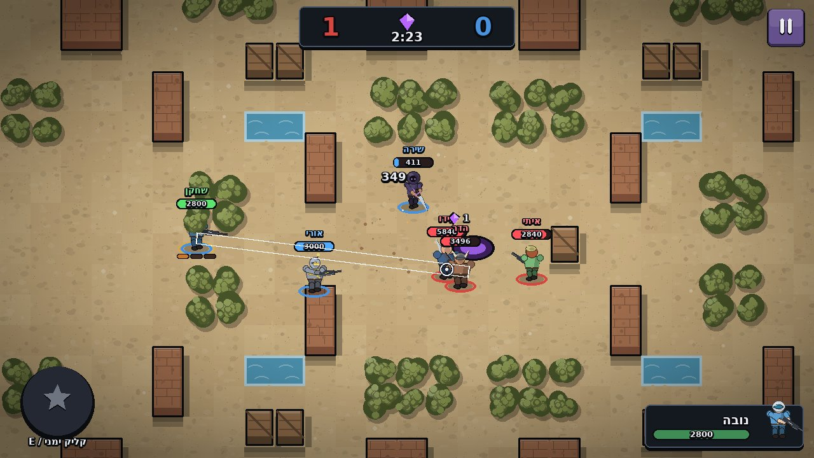
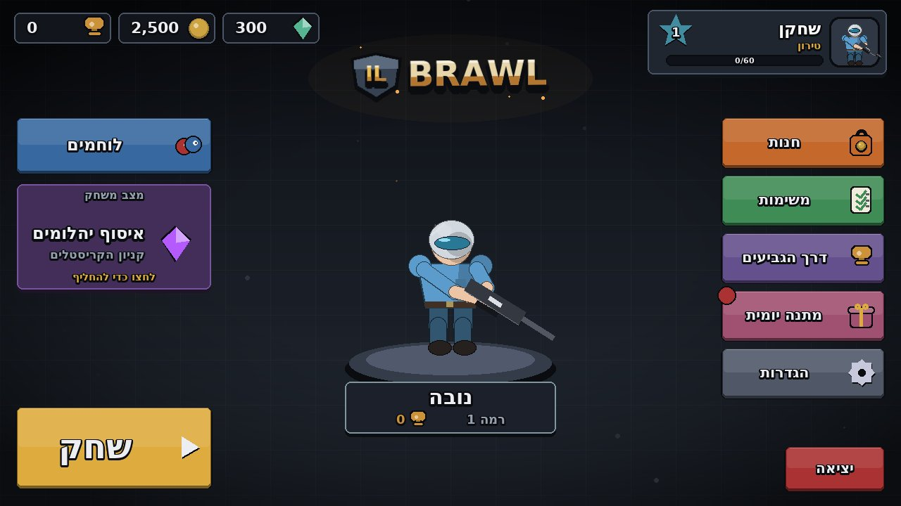
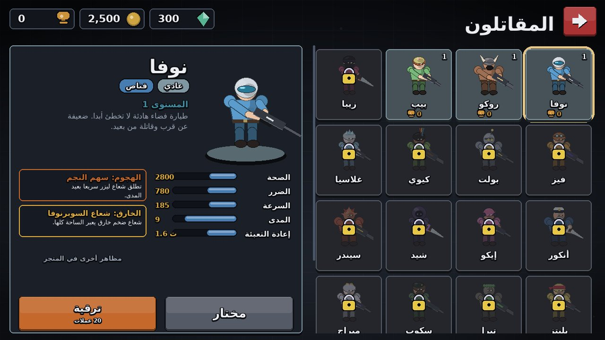
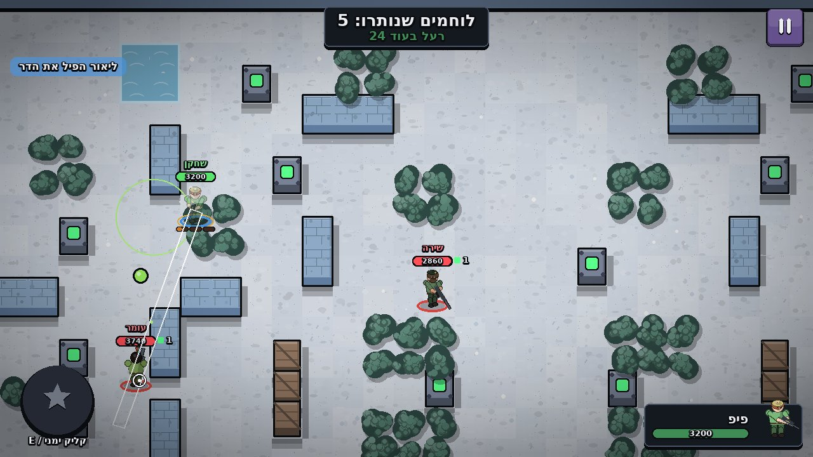
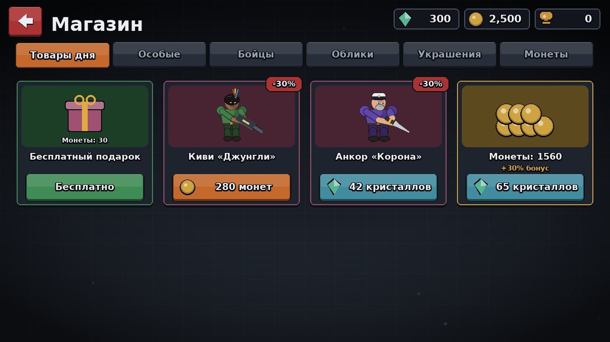

# IL Brawl

## ⬇ [הורדת המשחק (ZIP)](https://github.com/NEVO690/cluade/raw/HEAD/il-brawl/IL_Brawl.zip)  ·  [Download the game (ZIP)](https://github.com/NEVO690/cluade/raw/HEAD/il-brawl/IL_Brawl.zip)

חלצו את הקובץ ולחצו פעמיים על `run_game.bat` (צריך Python 3.9 ומעלה).



| | |
|---|---|
|  |  |
|  |  |


A colourful 2D top-down arena brawler built with Python and Pygame. It has 17 original brawlers, 5 game modes, 12 maps with an in-game map editor, smart bots at 4 difficulty levels, full progression with a shop, and 4 languages. Hebrew is the default language; Arabic and Hebrew use proper right-to-left layouts.

Everything in the game is original: characters, art (drawn in code), maps, music and sound effects (synthesised by `tools/generate_audio.py`). The only third-party asset is the DejaVu Sans font (free licence, see `assets/fonts/LICENSE-DejaVu.txt`). All currency is fictional and there are no real-money payments.

---

## הוראות מהירות (עברית)

1. התקינו Python 3.9 ומעלה מ-python.org (סמנו "Add python.exe to PATH").
2. לחצו פעמיים על `run_game.bat`. בהפעלה הראשונה הוא יתקין את pygame אוטומטית.
3. השליטה: WASD לתזוזה, העכבר לכיוון, כפתור שמאלי להתקפה, כפתור ימני (החזיקו ושחררו) או E לסופר, Q להתקפה עם כיוון אוטומטי, ESC להשהיה, F11 למסך מלא.

The game opens in Hebrew. You can switch language at any time in Settings, and the change applies instantly.

---

## Installing and running

**Windows (recommended):**
1. Install [Python 3.9+](https://www.python.org/downloads/) and tick "Add python.exe to PATH".
2. Double-click **`run_game.bat`**. On first run it installs pygame, then starts the game.

**Manual / other systems:**
```bash
pip install -r requirements.txt
python main.py
```

Requirements: Python 3.9+ and `pygame>=2.1.3` (`pygame-ce` also works).

## Controls (remappable in Settings → Controls)

| Action | Default |
|---|---|
| Move | W A S D (arrow keys also work) |
| Aim | Mouse |
| Attack | Left mouse button (hold for continuous fire) or Space |
| Super ability | Hold right mouse button to aim, release to fire, or press E to fire instantly |
| Auto-aim attack | Q |
| Pause | ESC |
| Fullscreen | F11 |

---

## Implemented features

### Game modes (each has its own rules, maps, victory conditions, timer, scoreboard and results screen)
- **Gem Collection** (3v3): gems spawn from a central mine. The first team to hold 10 or more gems through a 15‑second countdown wins. Knocked-out players drop their gems. Respawns are on.
- **Solo Survival** (6-player free-for-all): no respawns. A poison cloud closes in after 30 seconds. Break power boxes to get power cubes (+10% health and damage each). You are ranked by finishing place.
- **Team Survival** (3v3): elimination rounds with no respawns, best of 3. If the round timer runs out, the team with more health left wins the round.
- **Goal Rush** (3v3): carry the energy orb into the enemy goal, or throw it by attacking while you hold it. The carrier drops the orb when knocked out. The first team to 2 goals wins.
- **Zone Control** (3v3): stand in zones to capture them and hold them to earn points. The first team to 100 wins. Maps have 1, 2 or 3 zones.

### Brawlers: 17 originals across 5 classes and 6 rarities
| Class | Brawlers |
|---|---|
| Tank | Rocko, Anchor, Cinder |
| Assassin | Zippa, Shade, Blitz |
| Marksman | Nova, Bolt, Scope |
| Support | Pip, Kiwi, Echo, Mirage |
| Controller | Fizz, Glacia, Terra, Vortex |

Every brawler has its own health, damage, speed, range, reload, ammo, rarity, description, look, attack and super, plus an unlock requirement (starter, Trophy Road milestone, coins or gems).
- **Attack patterns:** single shot, shotgun spread, burst, flamethrower, piercing wave, wall-bouncing orb, boomerang blade, lobbed bomb (arcs over walls), and melee arc. Some attacks also heal allies.
- **Supers:** piercing beam, dash charge, healing zone, teleport strike, meteor, slowing blizzard, auto-turret, healing totem, decoy, fire ring, invisibility, shield aura, gravity well, stun shockwave, artillery rain, rage, and temporary walls.
- Character levels 1–9 (+6% health and damage per level, upgraded with coins).
- 20 skins (palette styles) that show in menus and in battle.

### Combat
- 360° mouse aiming, 8-direction movement and delta-time movement. The simulation runs at a fixed 60 Hz, separate from rendering.
- Ammo bars with reload, attack cooldowns, and super charge earned by landing hits (and by healing).
- Projectile physics: piercing, bouncing, returning and lobbed shots. Circle-versus-tile collision with wall sliding.
- Destructible crates, barrels and power boxes. Bushes hide brawlers (with proximity and attack reveal). Water blocks walking but not shots.
- Out-of-combat regeneration, knockback, slow, stun, shields, invisibility and spawn protection.
- Hit flashes, damage and heal numbers, particles, explosions, elimination bursts, screen shake and a kill feed.

### AI (opponents and teammates)
- Perceives the world realistically (it can't see into bushes), picks targets, and follows A* paths around walls.
- Plays the mode's objective: collects and protects gems, carries and throws the orb, captures zones, breaks power boxes, stays out of the poison.
- Keeps a preferred distance with strafing, dodges incoming shots, leads moving targets, retreats when low on health, protects carriers, and uses supers when the situation suits them.
- **Difficulties:** Easy, Normal, Hard, Expert (reaction time, aim error, dodge rate, aggression, ammo discipline).

### Maps and editor
- 12 original maps across 12 visual themes (desert, neon, volcano, temple, beach, city, meadow, candy, ruins, forest, snow, swamp), with walls, bushes, water, breakable cover, open areas, chokepoints and objectives.
- Maps are plain JSON (`data/maps/*.json`). The legend is in `tools/build_maps.py`.
- **In-game Map Editor** (Game Modes → Map Editor): paint 15 tile types with optional mirror symmetry, pick a theme, size and game modes, then name, validate, save, load and test-play the map. Custom maps appear in map selection automatically.

### Progression and economy (fictional currency only)
- Player profile with name, icon, title and name colour; player level and XP with level-up gem rewards.
- Trophies per brawler, total and highest trophies, and a **Trophy Road** with 20 milestones (coins, gems and brawler unlocks).
- Coins and gems; a **7-day daily gift** streak.
- **Daily missions:** 3 per day from 10 mission types.
- **Achievements:** 10 tiered achievements with gem rewards.
- Lifetime statistics, per-mode results and a match history of the last 30 matches.

### Shop
Daily deals (rotating each day, discounted, plus a free gift), special one-time bundles, brawler unlocks, skins, cosmetics (profile icons, titles, name colours) and coin packs. Every purchase asks you to confirm first.

### Languages
Hebrew (default), English, Arabic and Russian, with every string in `locales/*.json`.
- Built-in bidi reordering and Arabic letter shaping (no extra packages needed), with mirrored right-to-left layouts for Hebrew and Arabic.
- Language switches instantly without a restart and is saved.

### Settings
Language, music volume, sound effects volume, graphics quality (affects particles and detail), fullscreen, window resolution (or free resizing), control remapping, AI difficulty, FPS counter, screen shake, and resetting progress.

### Audio
Menu and battle music loops plus 30 sound effects (shots, lasers, explosions, supers, pickups, goals, victory and defeat, UI), all generated by `tools/generate_audio.py`. The game keeps working silently if no audio device is available.

### Quality
- Renders to a fixed 1280×720 canvas, scaled and letterboxed to any window size or resolution.
- Saves are atomic JSON with a rolling `.bak` backup; a corrupted save is recovered automatically. Missing assets fall back gracefully.
- Text, circles and portraits are cached and particle counts are capped, keeping memory use stable over long sessions.

---

## Project structure

```
main.py                 entry point
run_game.bat            Windows launcher (installs pygame on first run)
ilbrawl/
  engine/               game loop, scene stack, scaling, assets
  gameplay/             world simulation, entities, renderer, battle scene
  combat/               attacks, damage, healing, knockouts
  abilities/            the 17 super abilities
  characters/           procedural character art and portraits
  maps/                 tile map and collision, thumbnails, map editor
  modes/                the five game modes
  ai/                   bot brain and A* pathfinding
  menus/                lobby, brawlers, modes, shop, missions, road, profile, settings, results
  ui/                   widgets, HUD, text/RTL rendering, theme, icons, logo
  localization/         i18n tables and the bidi/Arabic shaping engine
  audio/                audio manager
  progression/          profile, missions, achievements
  shop/                 shop catalog and purchases
  save/                 safe JSON persistence
  settings/             settings with validation
data/                   characters, modes, maps, themes, shop, skins, cosmetics, progression (JSON)
locales/                he.json en.json ar.json ru.json
assets/                 fonts, sounds, music
tools/                  build_maps.py, generate_audio.py
tests/                  headless simulations and end-to-end UI tests
saves/                  created on first run (profile.json, settings.json, logs)
```

## Tests (optional)
```bash
python tests/sim_all.py      # bots play every mode on every map at Easy and Expert
python tests/test_flows.py   # clicks through menus, shop, missions, editor, a full match, saving and reloading
python tests/soak.py         # 68 full matches through the real scenes
```
The tests run headless (SDL dummy driver) and use a temporary save folder, so your progress is never touched.

## Customising
- Balance: edit `data/characters.json` (stats, attacks, supers) or `data/modes.json`.
- Economy: `data/progression.json`, `data/shop.json`, `data/skins.json`, `data/cosmetics.json`.
- Text: `locales/*.json`. To add a language, add its code to `LANGUAGES` in `ilbrawl/config.py` and create the matching JSON file.
- Your save files are in `saves/`. Delete them to start fresh.
